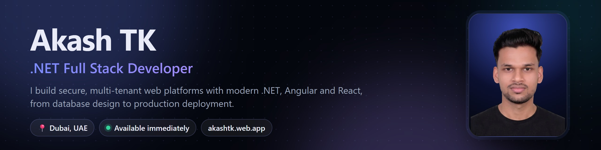
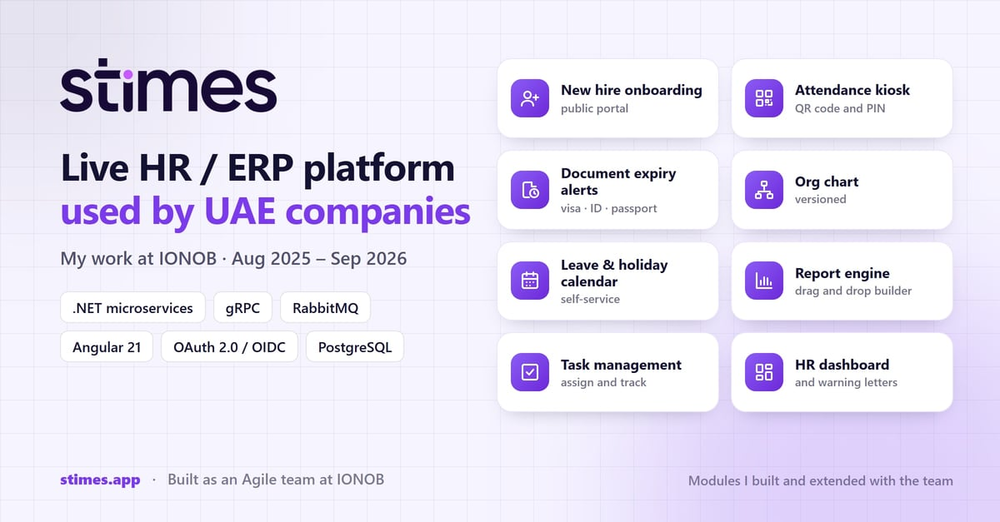
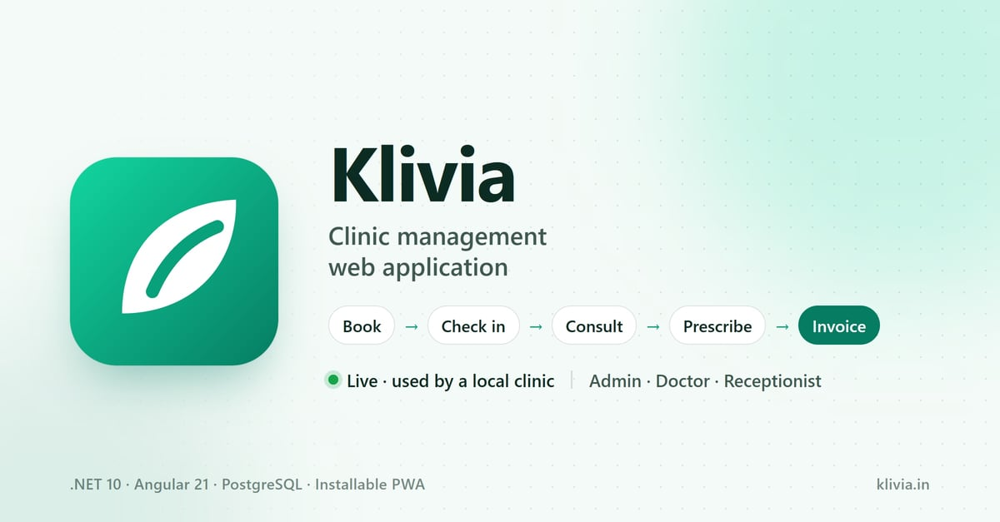
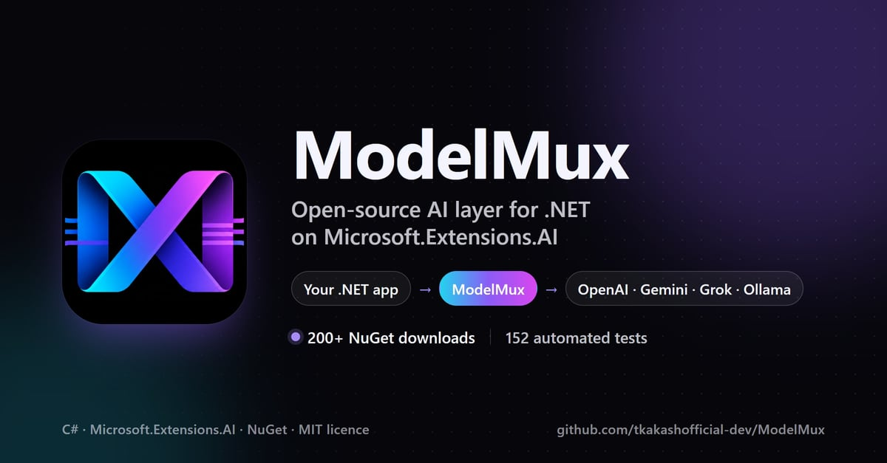
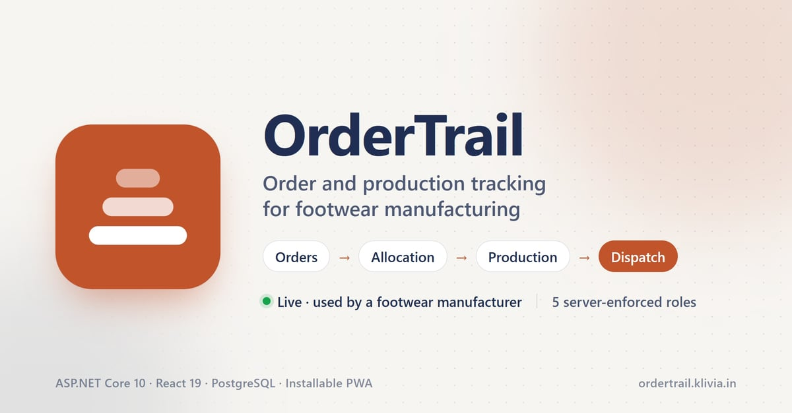
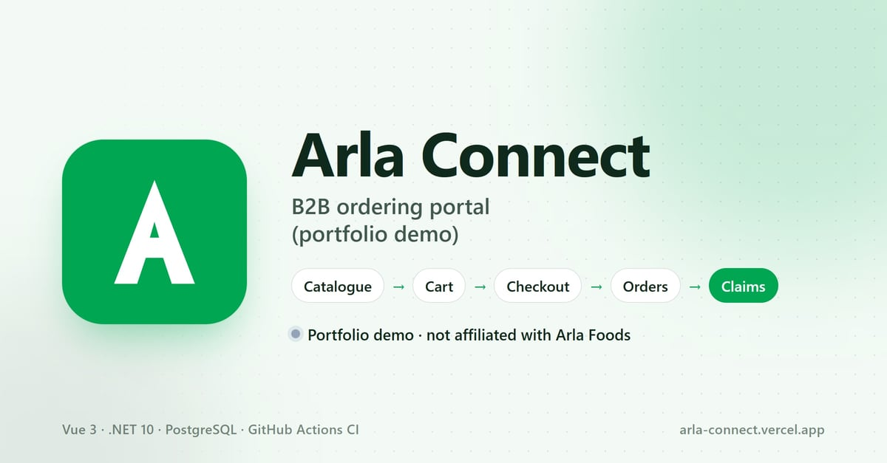
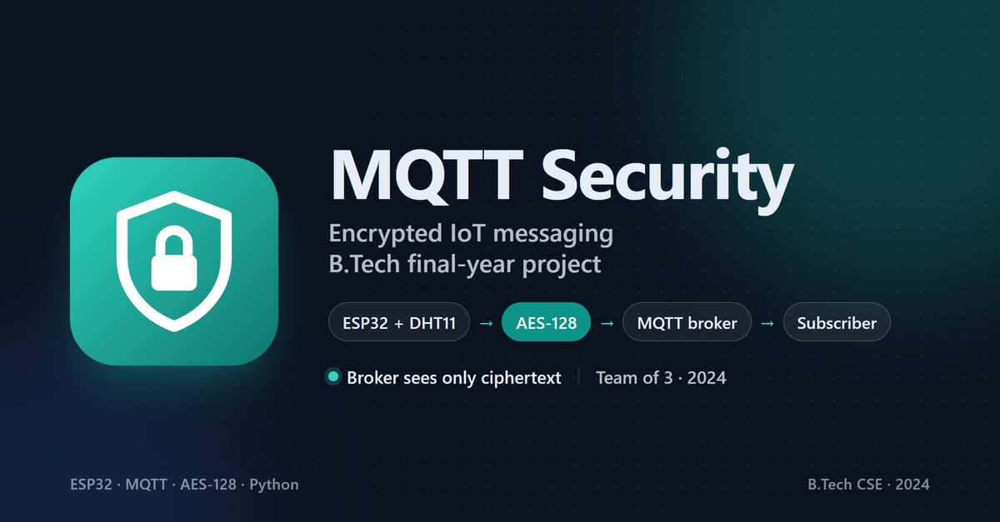
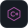

  &nbsp;
  &nbsp;
  &nbsp;
  

**2.5 years** building .NET microservices, Angular and React applications · based in Dubai · available immediately

### Experience

- **IONOB Innovations** · Software Developer (.NET / Angular) · Aug 2025 – Sep 2026 
  Worked in an Agile team on [Stimes](https://stimes.app), a live multi-tenant HR / ERP platform used by UAE companies: HR modules, a drag-and-drop report engine behind the HRMS reports, new .NET microservices over gRPC and RabbitMQ with a transactional outbox, the OAuth 2.0 / OpenID Connect login server and a public YARP gateway. *(Company code, so it is not on GitHub.)*
- **Gseven Technologies** · Full Stack .NET Developer · May 2024 – Jul 2025 
  Delivered six client web applications end to end, with Razorpay payments and WhatsApp Business API automation.

### Projects

<table>
  <tr>
    <td width="50%" valign="top">
      
      
<b>Stimes</b> · my work at IONOB Live multi-tenant HR / ERP platform used by UAE companies: HR modules, report engine, microservices and the login server.

    </td>
    <td width="50%" valign="top">
      
      
<b>Klivia</b> · <a href="https://klivia.in">klivia.in</a> Clinic management web application (.NET 10, Angular 21, PostgreSQL), built to learn complete web development, now used by a local clinic. Private repo.

    </td>
  </tr>
  <tr>
    <td width="50%" valign="top">
      
      
<b><a href="https://github.com/tkakashofficial-dev/ModelMux">ModelMux</a></b> · open source .NET AI library on Microsoft.Extensions.AI: one IChatClient for OpenAI, Gemini, Grok and Ollama. 2 NuGet packages, 200+ downloads each, 152 automated tests.

    </td>
    <td width="50%" valign="top">
      
      
<b>OrderTrail</b> · <a href="https://ordertrail.klivia.in">ordertrail.klivia.in</a> Order and production tracking (ASP.NET Core 10, React 19, PostgreSQL), built the same way, now used by a footwear manufacturer. Private repo.

    </td>
  </tr>
  <tr>
    <td width="50%" valign="top">
      
      
<b><a href="https://github.com/tkakashofficial-dev/arla-connect">Arla Connect</a></b> · portfolio demo B2B ordering portal in Vue 3 and .NET 10, with a buyer side and a back office. Not affiliated with Arla Foods. <a href="https://arla-connect.vercel.app">Live demo</a>

    </td>
    <td width="50%" valign="top">
      
      
<b>MQTT Security</b> · B.Tech final-year project Team of 3, 2024: AES-128 encryption of ESP32 sensor data before it is published over MQTT, so the broker only ever sees ciphertext.

    </td>
  </tr>
</table>

### Tech

  
  
  
  
  
  
  
  
  
  
  
  
  
  

**Backend:** C#, .NET 8 / .NET 10, ASP.NET Core, EF Core, gRPC, RabbitMQ (MassTransit), SignalR, Hangfire, Quartz.NET 
**Frontend:** Angular, React, TypeScript, Vue 3 
**Data:** SQL Server, PostgreSQL, MySQL, Redis 
**Security:** OAuth 2.0 / OpenID Connect (OpenIddict), JWT, multi-tenancy 
**DevOps:** Docker, Nginx, Linux, GitLab CI/CD, GitHub Actions 
**AI:** Microsoft.Extensions.AI, OpenAI, Claude, Gemini, Ollama
